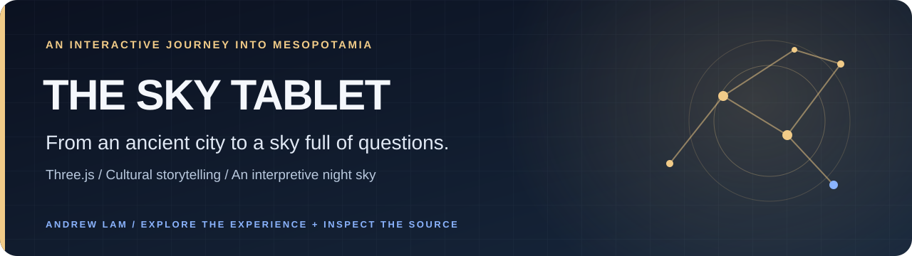
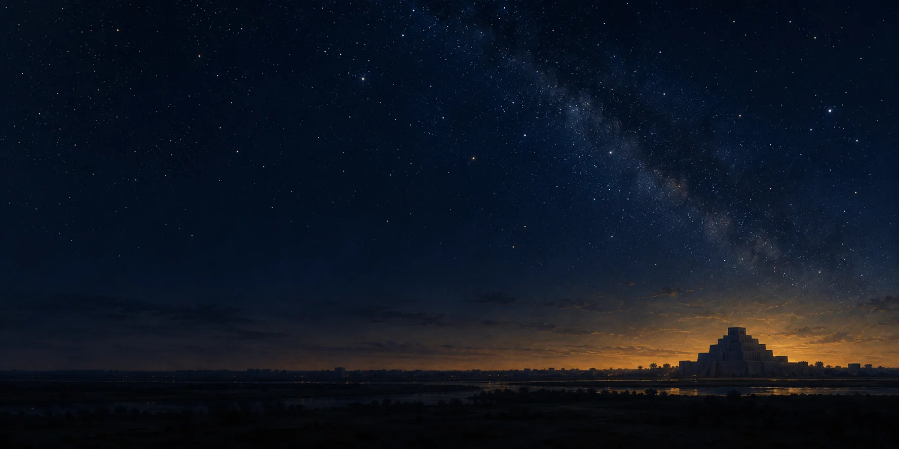
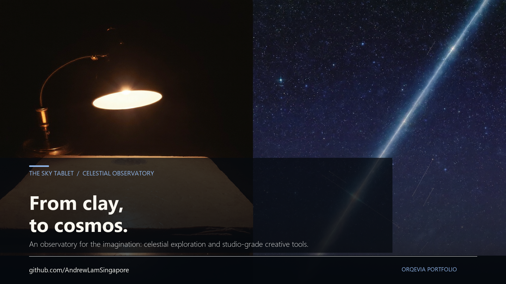

[](https://sky-tablet.vercel.app/)

# The Sky Tablet

**From an ancient city to a sky full of questions.**

[](https://sky-tablet.vercel.app/)

[**Enter the cinematic journey →**](https://sky-tablet.vercel.app/) · [**Connect with Andrew →**](https://authority-engine-app.vercel.app/contact?source=sky-tablet&intent=collaboration&utm_source=github&utm_medium=repository&utm_campaign=sky_tablet)

Start at street level. Pass through the gate. Encounter a clay tablet, then pull back into an open sky with **MUL — “star”**, **Venus, Jupiter and Mars** and the **Three Paths**. Switch to free exploration whenever curiosity takes over.

A browser-based experiment by **Andrew Lam**, bringing together cultural history, interactive storytelling and technology. Select sound to hear the original generative score. No account required.

## Start here

| You want to… | Go to |
| --- | --- |
| Enter the experience | [Cinematic journey](https://sky-tablet.vercel.app/) and [public build notes](https://sky-tablet.vercel.app/notes.html) |
| Run or inspect the source | [Run and verify](#run-and-verify) and [Interpretation Lens architecture](docs/INTERPRETATION_LENS_ARCHITECTURE.md) |
| Read or contribute evidence | [Interpretation limits](#evidence-and-limits), [asset provenance](docs/2026-09-16-cinematic-repair.md) and [research discussions](https://github.com/AndrewLamSingapore/sky-tablet/discussions) |

[Browse all six projects and their source](https://github.com/AndrewLamSingapore/AndrewLamSingapore#selected-work) · [About Andrew](https://authority-engine-app.vercel.app/about)

## What would you build from this?

A museum encounter? A learning experience? A different way to explain a difficult idea? Bring the question or the project you have in mind.

- [**Discuss a project with Andrew**](https://authority-engine-app.vercel.app/contact?source=sky-tablet&intent=collaboration&utm_source=github&utm_medium=repository)
- [**Share a research question or source**](https://authority-engine-app.vercel.app/contact?source=sky-tablet&intent=research&utm_source=github&utm_medium=repository)
- [**Stay connected on LinkedIn**](https://www.linkedin.com/in/lam-teck-sing-andrew-79886719)

If the experience interests you, **star this repository** to keep it within reach, or share the live link with someone who would enjoy exploring it.

## Current implementation

- A bounded visible-time camera clock, continuous transitions and orientation-preserving free exploration
- A final aerial city shot with courtyard neighborhoods, alleys, varied rooflines and horizon-scale terrain
- Wide sky framing on portrait, landscape and desktop, with MUL and three labeled planets visible together; a Wide sky shortcut
- Touch controls, with movement paused while reading the creator invitation
- Monumental inscribed tablet restored at the previous display scale with rounded edges, recessed wedge geometry and a stone display base
- Detailed tablet provenance available through Interpretation Lens instead of covering the cinematic reveal
- Public build notes linked from the Interpretation Lens, with optional email updates through a server-side Buttondown route
- Generated photographic-style masonry textures, layered temple terraces, 52 stair treads, recessed sanctuary, parapets and roof beams
- Distinct adult men and women, varied builds and hairstyles, linen-like material response, varied skin tones and finer facial geometry and subtle breathing/head movement on nearby figures
- Individually shaped palm crowns, curved tapered leaflets, ringed trunks and subtle wind movement
- Recessed, framed windows with independently varying warm lamp light and limited masonry spill
- Directional dusk lighting, tighter shadow coverage, two local lamps casting moving shadows, steady dusk shadows and a Temple view shortcut
- Distant point stars, a small moon and Venus, with an educational sky interpretation
- Instanced repeated geometry and bounded lighting to limit rendering overhead
- Clear routes to Andrew, ORQEVIA, VELYQUA, The Portal and Living Worlds

This replaces the former README’s sky wheel, synodic-cycle explorer and searchable sign-sampler description. Those are not the current interface.

## Evidence and limits

Planet positions are illustrative, not a sky chart for a particular date. MUL labels sky vocabulary, not a named astronomical object.

The scene is an interpretive software prototype, not a surveyed historical reconstruction or a date-accurate astronomical simulation. Generated textures and procedural people are not archaeological scans or photogrammetric humans. The visual target is maximum practical realism; full photorealism is not claimed.

Camera regression tests exercise the shipped camera and scene logic with real Three.js geometry/math and a stubbed renderer. They do not verify GPU appearance or physical iPhone performance. See [repair and asset provenance](docs/2026-09-16-cinematic-repair.md) and [Interpretation Lens purpose and ownership](docs/INTERPRETATION_LENS_ARCHITECTURE.md).

## Run and verify

Run the build-backed local server, then open http://127.0.0.1:8765 in a WebGL-capable browser. The build copies the locked Three.js modules into the site; no external CDN is required. `experience.html` owns the scene; `index.html` hosts the experience and sound controls.

```bash
npm ci
npm run check
npm run test:browser
npm run serve
```

Install test browsers once with `npx playwright install --with-deps chromium webkit`. CI uses Node 24 and the committed dependency lock. Browser checks run on every pull request and main push.

Local checks and the static preview need only Node 24; Python is not required. The preview binds to `127.0.0.1`, serves only the generated `public` directory, and supports byte-range video seeking. Both local signup routes report email delivery disabled, even if a provider credential exists in the shell. Use the public notes locally; deployed signup needs the Vercel server function. The older Python documentation guard remains an optional CI compatibility check.

Email signup requires a server-only `BUTTONDOWN_API_KEY` environment variable in Vercel. Notes remain public at `/notes.html` and do not require an email address.

Portfolio status: [STATUS.md](https://github.com/AndrewLamSingapore/orqevia/blob/main/STATUS.md) is the sole portfolio status reference. Each product owns its source, configuration, contracts and domain records. The [operational manifest](https://github.com/AndrewLamSingapore/orqevia/blob/main/governance/operational-manifest.json) provides dated ORQEVIA component and observation references; it does not establish deployment status.

Subscription routes share origin validation, an eight-second provider timeout and best-effort per-instance throttling (five requests per client in ten minutes). Distributed abuse protection requires a platform WAF rule. Missing credentials leave signup unavailable and display a notice; they do not count as a verified delivery integration.

## Campaign visual

Repository advertising creative, generated through the bounded Higgsfield
campaign (batch 2026-10-22, zero retries, under the US$0.03 cap):


